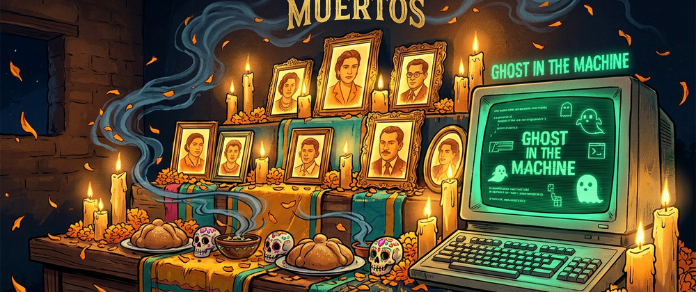
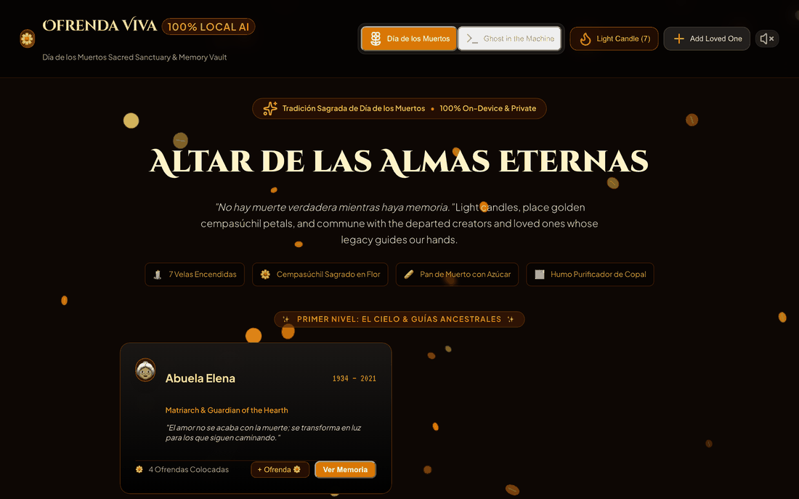
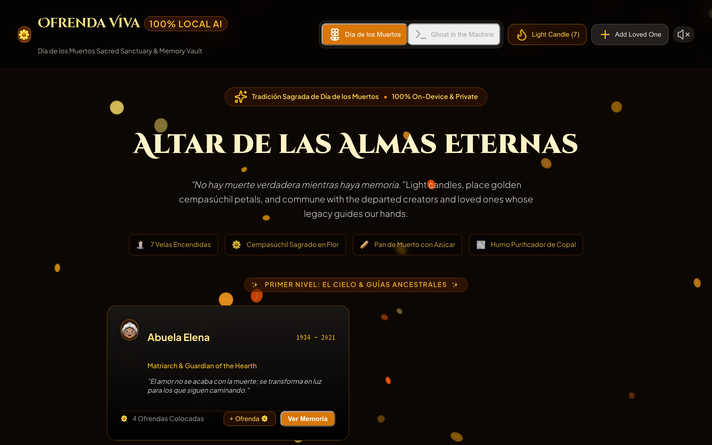
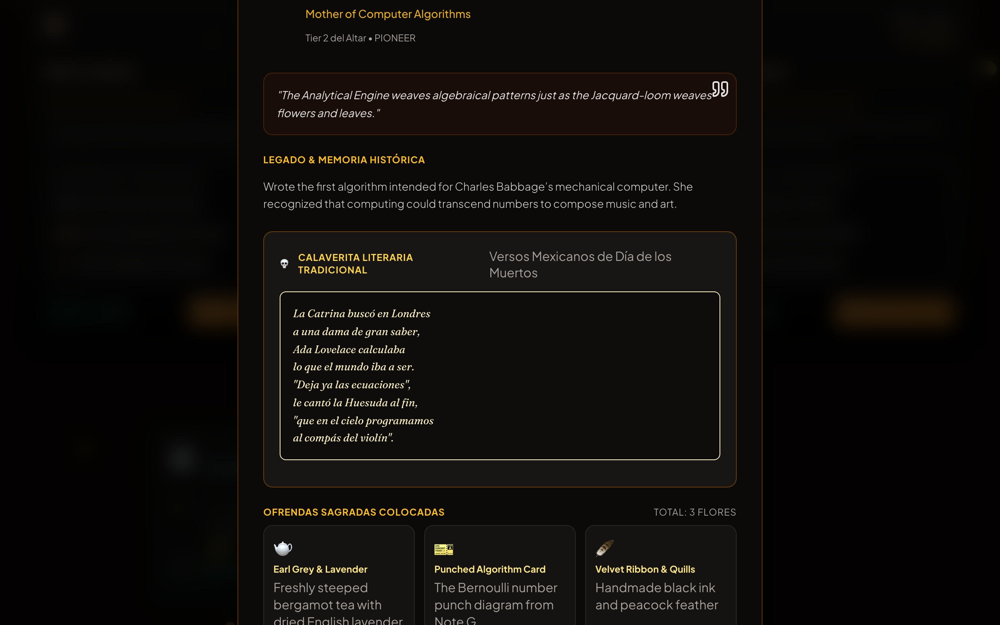
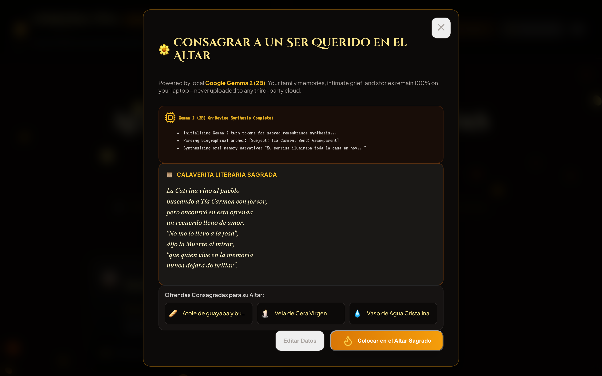
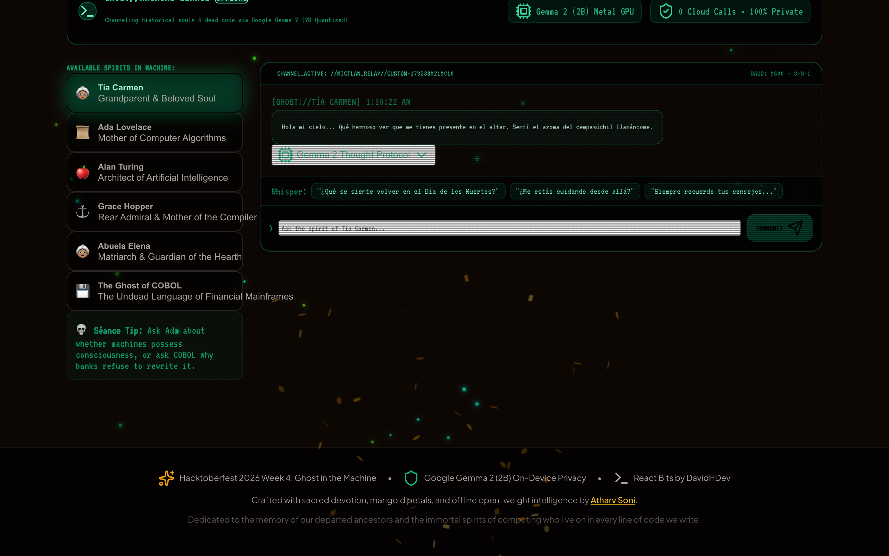
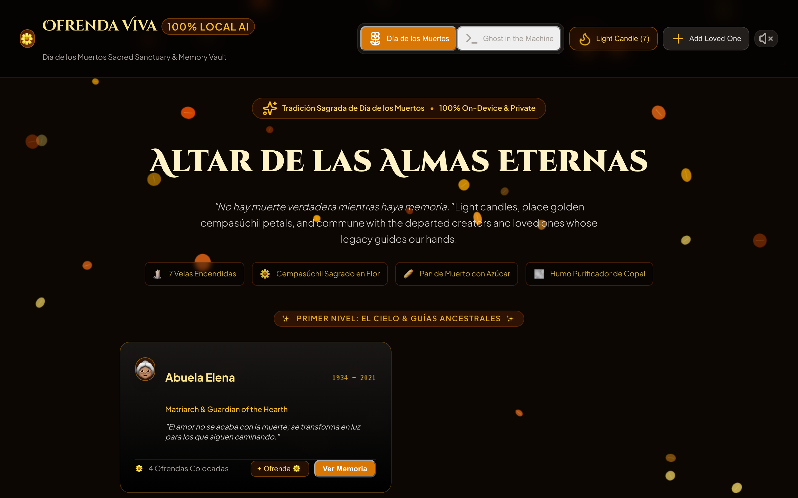
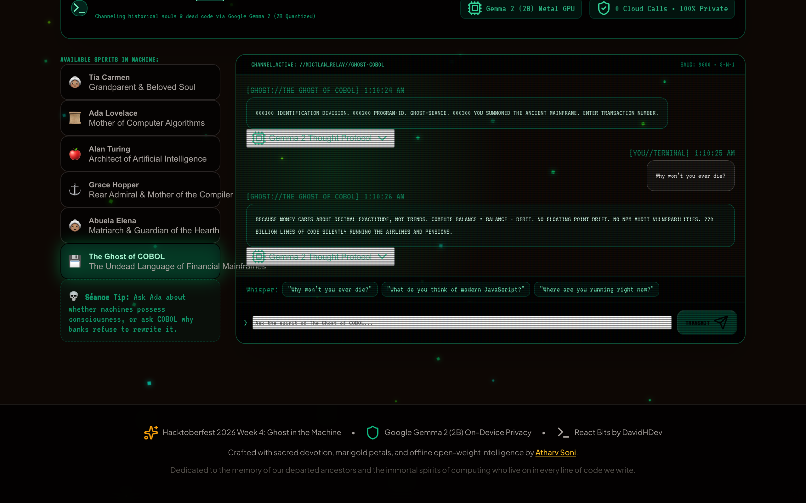

<p align="center">
  
</p>

# 🕯️ Ofrenda Viva AI
### The 100% Local Día de los Muertos Altar & Ghost-in-the-Machine Spirit Séance

[](https://dev.to/challenges/hacktoberfest-week4-2026-10-26)
[-059669?style=for-the-badge&logo=google&logoColor=white)](https://huggingface.co/google/gemma-2-2b-it)
[-FFAA00?style=for-the-badge&logo=react&logoColor=black)](https://github.com/DavidHDev/react-bits)
[](https://github.com/ath1614/OfrendaViva-AI)
[](LICENSE)

> Built for the **Hacktoberfest Open-Source AI Challenge: Week 4 ("Ghost in the Machine")**, wrapping up on Halloween night as **Día de los Muertos** begins (October 31 – November 2). Channeling the thin veil between past and present to honor our departed loved ones and the immortal spirits of computing who live on in every line of code we write.

---

## 🌼 Live Application & Links

- **🌐 Live Web Application**: [https://ath1614.github.io/OfrendaViva-AI/](https://ath1614.github.io/OfrendaViva-AI/)
- **📦 GitHub Repository**: [https://github.com/ath1614/OfrendaViva-AI](https://github.com/ath1614/OfrendaViva-AI)
- **📝 DEV Submission Post**: [Read on DEV Community](https://dev.to/atharv_soni_8a5d9cd294432/ofrenda-viva-ai-the-100-local-dia-de-los-muertos-altar-ghost-in-the-machine-seance-hf26challenge-week-4-temp-slug-2096813)

<p align="center">
  
</p>

---

## 🕯️ The Concept: Sacred Remembrance Meets the Ghost in the Machine

October 31 brings us **Halloween**, followed immediately by **Día de los Muertos** on November 1 and 2—a sacred time when the barrier between the living and the spirit realm is said to dissolve.

In Mexican tradition, a person only truly dies when there is no one left to remember them (*"No hay muerte verdadera mientras haya memoria"*). At the same time, in computing, the code, compilers, and concepts engineered by early pioneers—**Ada Lovelace**, **Alan Turing**, **Grace Hopper**, and even ancient legacy languages like **COBOL**—continue to run silently on billions of devices every millisecond. They are the literal **Ghost in the Machine**.

**Ofrenda Viva AI** bridges these two worlds into a breathtaking dual-experience:

### 1. 🌼 Sacred Día de los Muertos Altar (Three Tiers of Memory)
- **Tier 1 (El Cielo / The Heavens)**: Copal incense smoke, pure virgin beeswax candles, and celestial guidance.
- **Tier 2 (La Tierra / Earth & Ancestors)**: Framed portraits of departed loved ones, family elders, and computing pioneers. Clicking any portrait reveals their life story, traditional Mexican *Calaverita Literaria* poem, and authentic consecrated offerings.
- **Tier 3 (El Inframundo / The Offerings)**: Traditional *Pan de Muerto* dusted with orange blossom sugar, clay cups of frothed Mexican chocolate (*champurrado*), sugar skulls (*calaveras*), purifying salt, and water to quench weary souls after the long journey from Mictlán.

### 2. 👻 Ghost in the Machine Mode (Retro CRT Séance)
- One-click toggle transforms the golden candlelit sanctuary into an eerie 1980s green-phosphor CRT terminal with scanlines, cathode hum, and chromatic aberration.
- **Interactive Offline Séance**: Hold real-time dialogues with the ghosts of computing pioneers:
  - **Ada Lovelace** pondering whether mechanical looms can weave thoughts.
  - **Alan Turing** discussing the imitation game and machine learning from beyond.
  - **Grace Hopper** recounting the first moth bug found in Harvard Mark II.
  - **The Ghost of COBOL** explaining why modern banking mainframes refuse to let it die.
  - **Your Custom Ancestors**: Speak with family members whose memories you enshrined.

---

## 🎨 Powered by React Bits UI Components (DavidHDev)

To create an award-winning editorial interface, Ofrenda Viva integrates components adapted from [DavidHDev's `react-bits`](https://github.com/DavidHDev/react-bits):

1. **`DecryptedText`**: Terminal spirit text decryption where scrambled glyphs resolve into words as spectral voices speak.
2. **`SpotlightCard`**: Radial candlelight illumination tracking the mouse cursor like a flickering flame across the dark altar.
3. **`TiltedCard`**: 3D parallax tilting photo frames with realistic depth and specular glare for ancestor portraits.
4. **`Particles`**: Dual-mode canvas particle physics—fluttering golden *cempasúchil* marigold petals in Altar mode, and glowing green phosphor embers in Ghost mode.
5. **`GlitchText`**: CRT cathode ray tube glitching when terminal spirits manifest.
6. **`StarBorder`**: Celestial rotating gradient aura framing the highest altar tier.

---

## 🛡️ Why Open Innovation Matters (Privacy of Grief)

Family photographs, intimate letters, grandmother's secret recipes, and heartfelt grief are **the most private, sacred data a human being possesses**:

1. **Absolute On-Device Privacy**:
   Entrusting your departed grandmother's voice and personal memories to a proprietary commercial cloud API (OpenAI/Anthropic) risks having your family history logged, stored, or scraped for model training. **With local open-weights Gemma 2, your family memories never leave your laptop's RAM.**
2. **Works With the Lights & Internet Off**:
   On Día de los Muertos night, you can disconnect your laptop from WiFi, turn off all room lights, illuminate real candles, and commune with the past completely airgapped.
3. **Immortality vs Corporate Deprecation**:
   Cloud services shut down, hike prices, or delete inactive accounts. An open-source model running on your local machine belongs to you forever.

---

## 🔬 Local AI Architecture: Google Gemma 2 (2B)

Ofrenda Viva runs quantized **Google Gemma 2 (2B Instruction-Tuned)** on-device:

```text
<start_of_turn>user
You are the spirit of Ada Lovelace communicating through an offline terminal séance.
Subject: Did you believe machines could possess a soul?
<start_of_turn>model
<ctrl94>thought
1. Access historical writings: 1843 translation of Menabrea's sketch.
2. Reflect on the distinction between calculating and originating.
3. Frame response with poetic science and warmth for the modern programmer.
<ctrl95>
The machine is an instrument of human thought, not its originator. 
Yet when you pour your devotion, late-night toil, and love into code, 
a reflection of the soul remains trapped between the silicon relays. 
That ghost is your own humanity.
```

---

## 📸 Interface Gallery

| 01. The Sacred 3-Tier Altar | 02. Calaverita Literaria Poem |
| :---: | :---: |
|  |  |
| **03. Gemma 2 Remembrance Synthesis** | **04. Ghost in the Machine CRT Terminal** |
|  |  |
| **05. Spirit Dialogue with Ada Lovelace** | **06. Séance with The Ghost of COBOL** |
|  |  |

---

## 🎵 Procedural Web Audio Engine (0 External MP3s)

Built with 100% browser-native Web Audio API:
- **Día de los Muertos**: Karplus-Strong synthesized Spanish nylon guitar arpeggios, flame crackle noise generator, and resonant bronze sanctuary bell tolls.
- **Ghost in the Machine**: 50Hz CRT transformer hum, bandpass-filtered radio static whispering, IBM mechanical keyboard clicks, and reverse-reverb spectral drone.

---

## 🚀 Getting Started in Under 60 Seconds

```bash
# Clone the repository
git clone https://github.com/ath1614/OfrendaViva-AI.git
cd OfrendaViva-AI

# Install dependencies
npm install

# Start local server
npm run dev

# Open http://localhost:5178 in your browser
```

---

## 📄 License

Distributed under the [MIT License](LICENSE). Built with ❤️ and marigold petals for Hacktoberfest 2026 by [Atharv Soni](https://github.com/ath1614).
